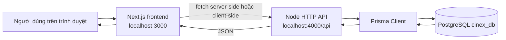
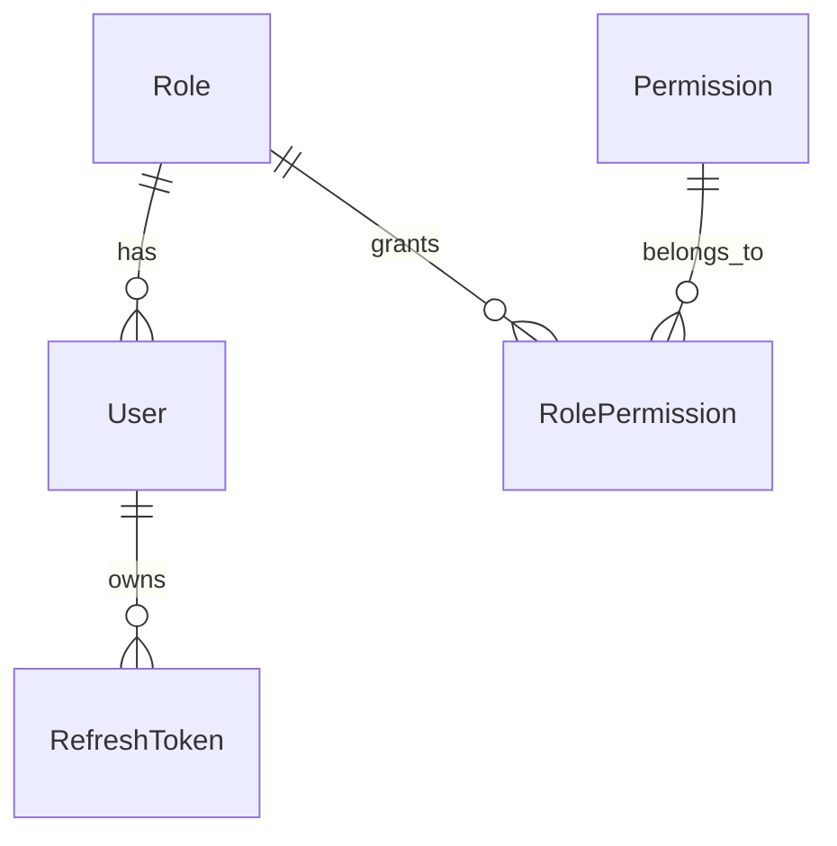
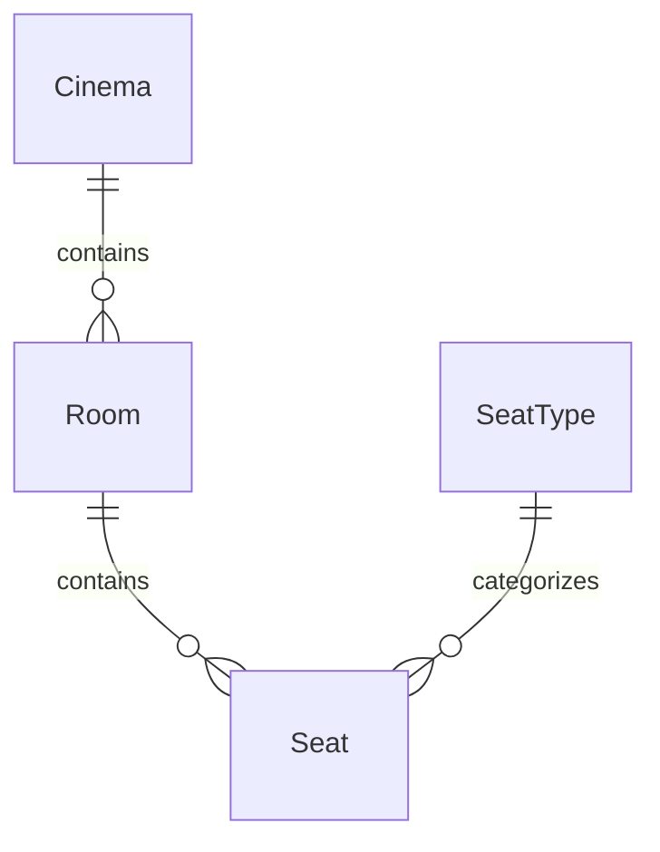
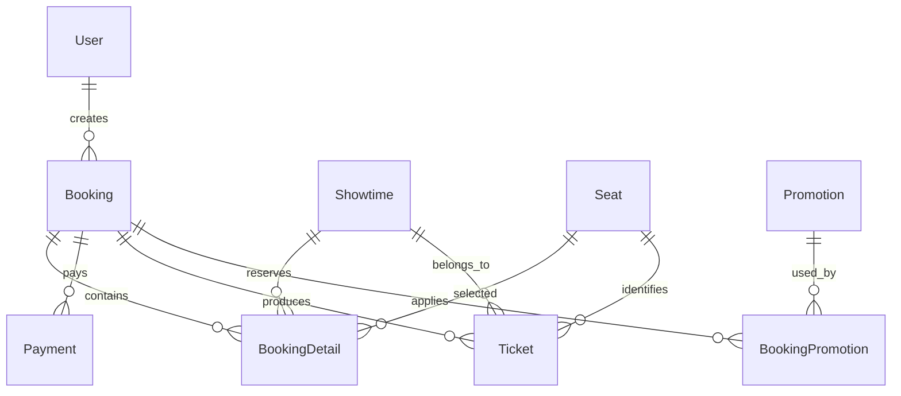
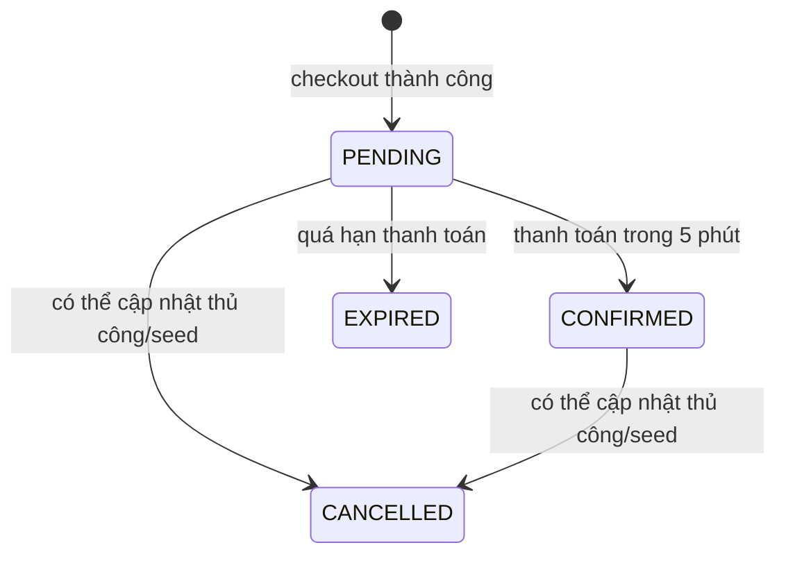
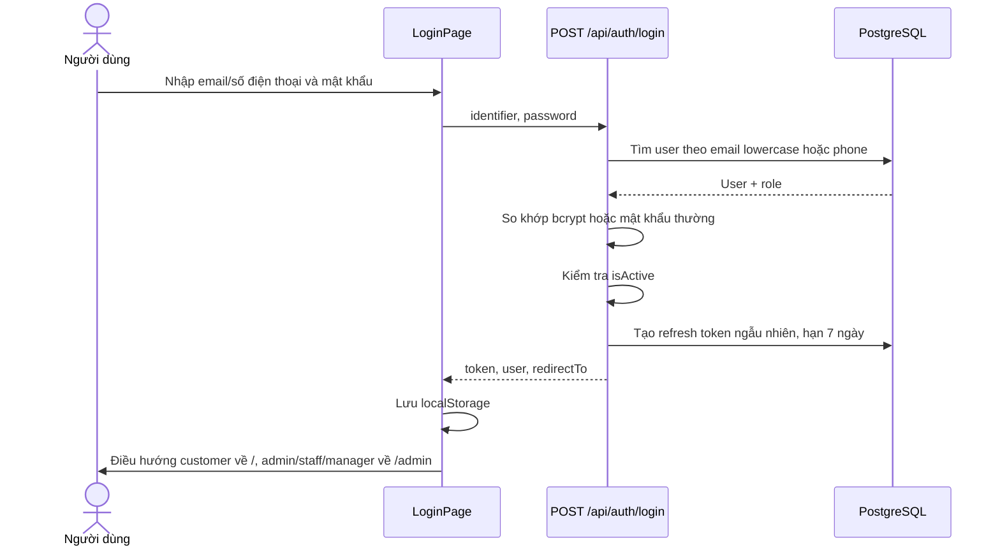
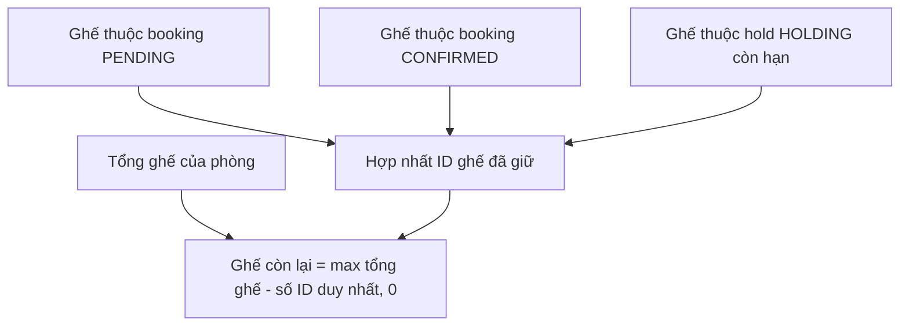
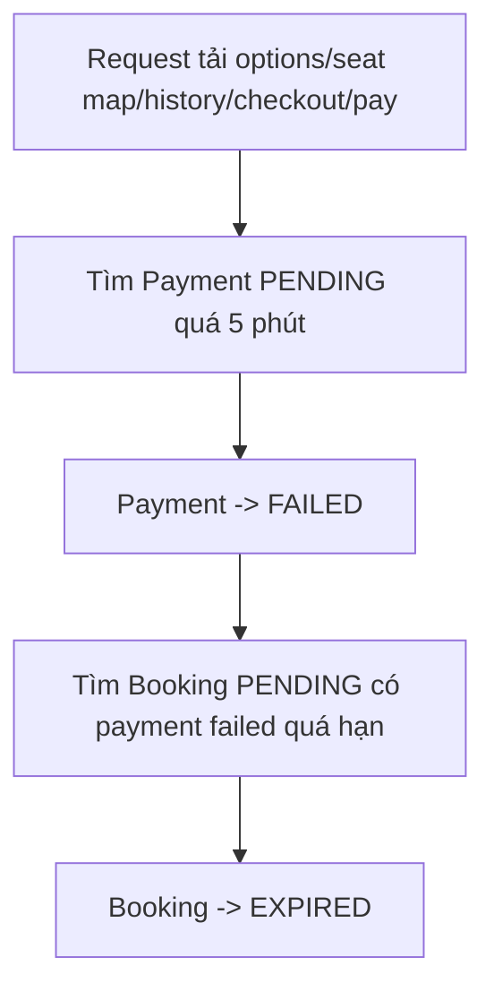

# Tài liệu logic và luồng hoạt động project CineX

> Cập nhật theo mã nguồn thực tế ngày 04/06/2026.
>
> Tài liệu này mô tả những gì project hiện đang thực sự làm, bao gồm kiến trúc,
> luồng dữ liệu, điều kiện nghiệp vụ, API, database, seed, các chức năng mới chỉ
> là giao diện mẫu và những hạn chế cần lưu ý.

## 1. Phạm vi và cách đọc tài liệu

Project CineX gồm ba lớp chính:

- `frontend`: ứng dụng Next.js hiển thị website khách hàng và khu admin.
- `backend`: HTTP server Node.js/TypeScript tự định tuyến, cung cấp REST API.
- PostgreSQL/Prisma: lưu dữ liệu người dùng, phim, rạp, lịch chiếu, ghế, đơn vé,
  thanh toán và các dữ liệu mở rộng.

Trong tài liệu, trạng thái chức năng được phân loại như sau:

| Trạng thái                  | Ý nghĩa                                                                        |
| ----------------------------- | -------------------------------------------------------------------------------- |
| Hoạt động qua API/database | Frontend gọi backend và dữ liệu được đọc/ghi trong PostgreSQL           |
| Hoạt động ở frontend      | Có xử lý tương tác nhưng chỉ dùng dữ liệu tĩnh nằm trong mã nguồn |
| Giao diện mẫu               | Có màn hình/nút nhưng chưa có logic nghiệp vụ hoặc API tương ứng    |
| Có model nhưng chưa dùng  | Database đã có bảng, nhưng chưa có API/màn hình sử dụng hoàn chỉnh  |

## 2. Kiến trúc tổng thể

### 2.1. Công nghệ

| Thành phần             | Công nghệ                                            |
| ------------------------ | ------------------------------------------------------ |
| Frontend                 | Next.js 16.2.4, React 19.2.4, TypeScript, Tailwind CSS |
| Backend                  | Node.js, TypeScript, HTTP server tự viết,`tsx`     |
| ORM                      | Prisma 7.8.0 với `@prisma/adapter-pg`               |
| Database                 | PostgreSQL                                             |
| Xác thực mật khẩu    | bcrypt                                                 |
| Biểu tượng giao diện | lucide-react, react-icons                              |

### 2.2. Luồng request tổng quát



### 2.3. Kiểu render của frontend

Frontend dùng đồng thời Server Component và Client Component:

- Server Component:
  - Trang chủ `/`.
  - Danh sách phim `/movies/now-showing`, `/movies/coming-soon`.
  - Chi tiết phim `/movies/[id]`.
  - Các trang này gọi API từ server Next.js trước khi trả HTML.
- Client Component:
  - Đăng nhập, đăng ký, hồ sơ, lịch sử đặt vé.
  - Đặt vé, sơ đồ ghế, quick booking.
  - Trang lịch chiếu tĩnh, thể loại tĩnh.
  - Các component này dùng state, effect và gọi API trực tiếp từ trình duyệt.

### 2.4. Cấu trúc thư mục quan trọng

```text
CineX/
├─ backend/
│  ├─ src/server.ts                 # Toàn bộ REST API và nghiệp vụ backend
│  ├─ prisma/schema.prisma          # Schema database
│  ├─ prisma/migrations/            # Migration PostgreSQL
│  └─ prisma/seed/                  # Seed toàn bộ dữ liệu mẫu
├─ frontend/
│  ├─ app/(site)/                   # Các route website khách hàng
│  ├─ app/(admin)/admin/            # Các route khu quản trị
│  ├─ components/                   # Component dùng lại
│  └─ lib/                          # API client, auth localStorage, navigation
└─ documents/                       # Tài liệu đồ án và tài liệu project
```

## 3. Khởi động hệ thống và cấu hình

### 3.1. Backend

Backend cần biến môi trường `DATABASE_URL` trỏ đến PostgreSQL.

```bash
cd backend
npm.cmd run start
```

Chế độ theo dõi thay đổi:

```bash
npm.cmd run dev
```

Seed dữ liệu:

```bash
npm.cmd run seed
```

Backend mặc định chạy tại:

```text
http://localhost:4000
```

### 3.2. Frontend

```bash
cd frontend
npm.cmd run dev
```

Frontend mặc định chạy tại:

```text
http://localhost:3000
```

Frontend lấy API base URL theo:

```text
NEXT_PUBLIC_API_BASE_URL
```

Nếu không cấu hình, các API client tự dùng:

```text
http://localhost:4000/api
```

## 4. Hạ tầng dùng chung

## 4.1. Backend HTTP server

Backend không dùng Express/NestJS. Toàn bộ định tuyến nằm trong
`backend/src/server.ts`.

Luồng xử lý mỗi request:

1. Gắn CORS header.
2. Nếu là `OPTIONS`, trả `204`.
3. Parse URL bằng `new URL(...)`.
4. So khớp method và pathname tuần tự trong `handleRequest`.
5. Gọi handler tương ứng.
6. Handler truy vấn/cập nhật database bằng Prisma.
7. Trả JSON bằng `sendJson`.
8. Nếu có exception chưa xử lý, trả `500` cùng message của exception.

Cấu hình backend quan trọng:

| Cấu hình                     | Giá trị/logic                    |
| ------------------------------ | ---------------------------------- |
| Port                           | `PORT`, mặc định `4000`     |
| CORS                           | `CORS_ORIGIN`, mặc định `*` |
| JSON body tối đa             | 15.000.000 ký tự                 |
| Avatar tối đa                | 10 MB                              |
| Thời gian thanh toán pending | 5 phút                            |
| Phân trang phim mặc định   | 9 phim/trang                       |
| Phân trang phim tối đa      | 24 phim/trang                      |
| Múi giờ hiển thị           | `Asia/Ho_Chi_Minh`               |

## 4.2. Chuẩn hóa dữ liệu backend

Backend có lớp serialize thủ công để chuyển dữ liệu Prisma thành JSON dùng cho
frontend:

- Date chuyển thành ISO string.
- Ngày/giờ hiển thị định dạng Việt Nam.
- Decimal chuyển thành `number`.
- Tiền chuyển thành chuỗi VND.
- Trạng thái phim chuyển từ mã enum sang nhãn tiếng Việt.
- Điểm review 5 sao được nhân đôi thành thang 10.
- Ghế còn trống được tính từ tổng ghế trừ các ghế thuộc:
  - booking `PENDING`;
  - booking `CONFIRMED`;
  - seat hold `HOLDING` còn hạn.

## 4.3. API client của frontend

Frontend chia API client thành ba file:

| File                                   | Trách nhiệm                                                               |
| -------------------------------------- | --------------------------------------------------------------------------- |
| `frontend/lib/home-movies.ts`        | Trang chủ, danh sách phim, chi tiết phim                                 |
| `frontend/lib/auth-api.ts`           | Đăng nhập, đăng ký, hồ sơ, mật khẩu, lịch sử đơn, thanh toán |
| `frontend/lib/ticket-booking-api.ts` | Tùy chọn đặt vé, sơ đồ ghế, checkout                               |

Các API client đều:

1. Gọi `fetch`.
2. Parse JSON nếu có.
3. Nếu backend không kết nối được, ném lỗi thân thiện.
4. Nếu status không thành công, lấy `message` do backend trả về.

Riêng `home-movies.ts` không ném lỗi ra UI mà trả một object rỗng có trường
`error`, giúp Server Component vẫn render được trang.

## 4.4. Xác thực ở frontend

Thông tin đăng nhập được lưu trong `localStorage`:

| Key                        | Nội dung                             |
| -------------------------- | ------------------------------------- |
| `cinex_auth_user`        | JSON thông tin user                  |
| `cinex_auth_token`       | Token dùng cho Bearer Authentication |
| `cinex_remember_account` | Cờ giao diện ghi nhớ tài khoản   |

`frontend/lib/auth.ts` chịu trách nhiệm:

- đọc user/token;
- lưu user/token;
- xóa user/token khi logout;
- phát event `cinex-auth-change` để Header cập nhật ngay;
- nhận diện role admin gồm `ADMIN`, `MANAGER`, `STAFF`;
- chọn đường dẫn sau đăng nhập: admin về `/admin`, customer về `/`.

## 4.5. Màn hình loading khi điều hướng

Root layout gắn `NavigationInterceptor` vào toàn hệ thống.

Luồng điều hướng nội bộ:

1. Người dùng click một link nội bộ.
2. Interceptor kiểm tra link không phải external, download, hash, mail, tel hoặc
   cùng route hiện tại.
3. Click gốc bị chặn.
4. Frontend điều hướng đến `/loading?to=<route đích>`.
5. `LoadingRedirectTemplate` hiển thị loading trong 1.500 ms.
6. Route đích được kiểm tra bằng `sanitizeInternalPath`.
7. Router dùng `replace` để chuyển sang route đích.

Mục đích của `sanitizeInternalPath` là chặn open redirect sang domain khác và
chặn vòng lặp về chính `/loading`.

## 5. Mô hình dữ liệu và quan hệ nghiệp vụ

## 5.1. Nhóm phân quyền và người dùng

| Bảng                | Vai trò                                             |
| -------------------- | ---------------------------------------------------- |
| `roles`            | Vai trò ADMIN, MANAGER, STAFF, CUSTOMER             |
| `permissions`      | Danh sách quyền chi tiết                          |
| `role_permissions` | Quan hệ nhiều-nhiều role và permission           |
| `users`            | Hồ sơ, mật khẩu, role, trạng thái hoạt động |
| `refresh_tokens`   | Token đăng nhập có hạn 7 ngày và cờ revoked  |

Quan hệ:



## 5.2. Nhóm phim

| Bảng            | Vai trò                                      |
| ---------------- | --------------------------------------------- |
| `movies`       | Thông tin phim và trạng thái              |
| `genres`       | Thể loại                                    |
| `movie_genres` | Quan hệ nhiều-nhiều phim và thể loại    |
| `movie_images` | Ảnh bổ sung của phim                       |
| `reviews`      | Review duy nhất của một user cho một phim |

Trạng thái phim:

```text
COMING_SOON -> NOW_SHOWING -> ENDED
```

Code hiện không tự chuyển trạng thái theo ngày. Trạng thái được seed/cập nhật
trực tiếp trong database.

## 5.3. Nhóm rạp, phòng và ghế

| Bảng          | Vai trò                         |
| -------------- | -------------------------------- |
| `cinemas`    | Cụm rạp                        |
| `rooms`      | Phòng chiếu thuộc rạp        |
| `seat_types` | NORMAL, VIP, COUPLE và phụ thu |
| `seats`      | Ghế vật lý trong phòng       |

Quan hệ:



Ràng buộc chính:

- Tên phòng không trùng trong cùng rạp.
- Mã ghế không trùng trong cùng phòng.
- Vị trí `rowName + seatNumber` không trùng trong cùng phòng.

## 5.4. Nhóm lịch chiếu và giá ghế

| Bảng               | Vai trò                                                |
| ------------------- | ------------------------------------------------------- |
| `showtimes`       | Phim, phòng, giờ bắt đầu/kết thúc, giá cơ bản |
| `showtime_prices` | Giá cụ thể của từng ghế trong từng suất         |

Công thức giá seed hiện tại:

```text
giá ghế = giá cơ bản theo khung giờ
         + phụ thu phòng có tên kết thúc bằng "2"
         + phụ thu loại ghế
```

Phụ thu loại ghế:

| Loại ghế | Phụ thu |
| ---------- | -------: |
| NORMAL     |        0 |
| VIP        | 20.000đ |
| COUPLE     | 40.000đ |

## 5.5. Nhóm đặt vé, thanh toán và vé

| Bảng                  | Vai trò                                 |
| ---------------------- | ---------------------------------------- |
| `bookings`           | Đơn đặt vé tổng                    |
| `booking_details`    | Ghế và giá của từng vé trong đơn |
| `seat_holds`         | Giữ ghế tạm thời                     |
| `payments`           | Giao dịch thanh toán                   |
| `tickets`            | Vé điện tử sau khi thanh toán       |
| `promotions`         | Mã khuyến mãi                         |
| `booking_promotions` | Khuyến mãi đã áp dụng cho đơn    |

Quan hệ chính:



Trạng thái đơn:



Trạng thái thanh toán:

```text
PENDING -> SUCCESS
PENDING -> FAILED
SUCCESS -> REFUNDED
```

Trạng thái vé:

```text
ACTIVE -> USED
ACTIVE -> CANCELLED
```

## 5.6. Nhóm dữ liệu mở rộng

| Bảng          | Tình trạng sử dụng                                                    |
| -------------- | ------------------------------------------------------------------------- |
| `banners`    | Có seed, chưa được API trang chủ sử dụng                          |
| `news`       | Có seed, chưa có route/API tin tức                                    |
| `audit_logs` | Có seed, chưa có API/màn hình nhật ký                              |
| `promotions` | Có seed và booking seed sử dụng, checkout thật chưa áp dụng       |
| `reviews`    | Có seed, được dùng để tính điểm phim; chưa có API tạo review |

## 6. Danh sách API hiện có

| Method | Endpoint                             | Auth         | Chức năng                       |
| ------ | ------------------------------------ | ------------ | --------------------------------- |
| GET    | `/health`                          | Không       | Kiểm tra backend                 |
| GET    | `/api/home`                        | Không       | Dữ liệu trang chủ              |
| GET    | `/api/movies/now-showing`          | Không       | Phim đang chiếu có phân trang |
| GET    | `/api/movies/coming-soon`          | Không       | Phim sắp chiếu có phân trang  |
| GET    | `/api/movies/:id`                  | Không       | Chi tiết phim                    |
| GET    | `/api/booking/options`             | Không       | Toàn bộ tùy chọn đặt vé    |
| GET    | `/api/booking/showtimes/:id/seats` | Không       | Sơ đồ ghế của suất chiếu   |
| POST   | `/api/booking/checkout`            | Bearer token | Tạo đơn pending                |
| POST   | `/api/auth/login`                  | Không       | Đăng nhập                      |
| POST   | `/api/auth/register`               | Không       | Đăng ký customer               |
| GET    | `/api/account/profile`             | Bearer token | Lấy hồ sơ                      |
| PUT    | `/api/account/profile`             | Bearer token | Cập nhật hồ sơ/avatar         |
| PUT    | `/api/account/password`            | Bearer token | Đổi mật khẩu                  |
| GET    | `/api/account/bookings`            | Bearer token | Lịch sử đặt vé               |
| POST   | `/api/account/bookings/:id/pay`    | Bearer token | Thanh toán đơn pending         |

## 7. Logic xác thực và tài khoản

## 7.1. Đăng nhập

Frontend route: `/login`
Backend API: `POST /api/auth/login`

Luồng:



Điều kiện backend:

- Bắt buộc identifier và password.
- Có thể đăng nhập bằng email hoặc số điện thoại.
- Email được lowercase trước khi tìm.
- Sai thông tin trả `401`.
- User bị khóa (`isActive = false`) trả `403`.
- Token là chuỗi hex ngẫu nhiên từ 48 byte, lưu trong bảng `refresh_tokens`.

Cờ “ghi nhớ tài khoản” hiện chỉ lưu/xóa `cinex_remember_account`; token vẫn luôn
được lưu trong localStorage bất kể lựa chọn này.

## 7.2. Đăng ký

Frontend route: `/register`
Backend API: `POST /api/auth/register`

Luồng:

1. Frontend kiểm tra mật khẩu xác nhận khớp.
2. Gửi họ tên, email, phone tùy chọn và password.
3. Backend yêu cầu họ tên, email, password.
4. Backend yêu cầu password tối thiểu 6 ký tự.
5. Backend chặn email trùng.
6. Backend bảo đảm role `CUSTOMER` tồn tại bằng `upsert`.
7. Password được bcrypt hash với cost 10.
8. Tạo user active.
9. Tạo token 7 ngày.
10. Frontend lưu user/token và đăng nhập ngay.

## 7.3. Xác thực Bearer token

Các API tài khoản và checkout gọi `getAuthenticatedUser`:

1. Đọc header `Authorization: Bearer <token>`.
2. Tìm token trong `refresh_tokens`.
3. Token phải:
   - chưa revoked;
   - chưa hết hạn;
   - thuộc user tồn tại;
   - user đang active.
4. Nếu không thỏa mãn, handler trả `401`.

## 7.4. Đăng xuất

Đăng xuất hiện chỉ thực hiện ở frontend:

1. Xóa `cinex_auth_user`.
2. Xóa `cinex_auth_token`.
3. Phát event cập nhật Header.
4. Điều hướng về trang chủ.

Backend chưa có endpoint logout để đặt `refresh_tokens.revoked = true`.

## 7.5. Hồ sơ cá nhân

Frontend route: `/account/profile`

Khi mở trang:

1. Đọc local user và token.
2. Nếu thiếu, điều hướng về `/login`.
3. Điền form tạm bằng local user để hiển thị nhanh.
4. Gọi `GET /api/account/profile`.
5. Đồng bộ user mới nhất về form và localStorage.

Cập nhật hồ sơ qua `PUT /api/account/profile`:

- Bắt buộc full name và email.
- Backend kiểm tra định dạng email.
- Backend chặn email thuộc user khác.
- Phone rỗng được lưu thành `null`.
- Avatar hỗ trợ:
  - đường dẫn nội bộ bắt đầu bằng `/`;
  - URL HTTP/HTTPS;
  - data URL JPEG/PNG/WEBP.
- Frontend và backend cùng giới hạn avatar 10 MB.
- Avatar upload được đọc thành data URL và lưu trực tiếp vào cột `users.avatar`.

## 7.6. Đổi mật khẩu

API: `PUT /api/account/password`

Luồng:

1. Frontend kiểm tra mật khẩu mới tối thiểu 6 ký tự.
2. Frontend kiểm tra xác nhận mật khẩu khớp.
3. Backend xác thực token.
4. Backend kiểm tra mật khẩu hiện tại.
5. Backend hash mật khẩu mới.
6. Cập nhật `users.password`.

Token cũ không bị revoke sau khi đổi mật khẩu.

## 8. Logic trang chủ

Frontend route: `/`
API: `GET /api/home`

## 8.1. Backend tải dữ liệu trang chủ

`loadHomePageData` thực hiện song song:

- tải toàn bộ phim cùng genres, images, reviews không bị ẩn và các suất chiếu
  `ACTIVE` có `startTime >= thời điểm hiện tại`;
- tải toàn bộ rạp cùng số phòng `ACTIVE`.

Sau đó backend:

1. Serialize từng phim.
2. Sắp xếp phim theo ưu tiên:
   - `NOW_SHOWING`;
   - `COMING_SOON`;
   - `ENDED`;
   - sau đó theo ngày phát hành mới hơn.
3. Chọn tối đa 9 phim đang chiếu mới cập nhật.
4. Chọn tối đa 9 phim sắp chiếu mới cập nhật.
5. Chọn tối đa 5 hero movie từ nhóm đang chiếu, fallback sang toàn bộ phim.
6. Gom toàn bộ suất sắp tới, sắp theo `startTime`.
7. Tạo tối đa 5 ngày lịch gần nhất.
8. Chỉ trả quick showtimes thuộc các ngày đã chọn.

Response chính:

```text
movies
heroMovies
nowShowingMovies
comingSoonMovies
quickBooking.dates
quickBooking.cinemas
quickBooking.showtimes
```

## 8.2. Hero slider

`HeroMoviesSlider`:

- tự chuyển phim sau mỗi 5.200 ms;
- cho phép chuyển slide trước/sau;
- cho phép click chấm để chọn slide;
- hiển thị trạng thái, rating, thời lượng, ngôn ngữ, genres;
- liên kết đặt vé bằng query `movie=<slug>`;
- liên kết chi tiết phim;
- trailer mở tab mới nếu có URL;
- các giờ gần nhất liên kết sang đặt vé bằng query `movie` và `time`.

## 8.3. Quick booking

`QuickBookingPanel` nhận dữ liệu từ API trang chủ.

Khởi tạo:

1. Ngày mặc định là ngày của suất đầu tiên.
2. Rạp mặc định là rạp có suất đầu tiên trong ngày đó.
3. Nếu rạp đang chọn không có suất trong ngày mới, component tự chuyển sang rạp
   đầu tiên có suất trong ngày.
4. Lọc danh sách suất theo đúng ngày và rạp active.
5. Đếm số suất còn ít nhất một ghế.

Mỗi card suất chiếu:

- hiển thị giờ, phim, phòng, ngôn ngữ, số ghế, giá;
- nếu hết ghế thì card không click được;
- nếu còn ghế thì đi đến `/ticket-booking?showtime=<id>`.

Nếu không có `dates` hoặc không có `cinemas`, panel hiển thị trạng thái chưa có
lịch chiếu.

## 8.4. Danh sách phim và thông tin rạp trên trang chủ

- `NowShowingMovies` và `ComingSoonMovies` dùng component chung
  `HomeMovieSection`.
- Các card có liên kết chi tiết, trailer, đặt vé/nhắc tôi.
- Khu vực cinema highlight dùng danh sách rạp từ API, lấy tối đa 3 rạp.
- Các nội dung “vé điện tử”, “phòng đa định dạng”, “combo bắp nước” là nội dung
  giao diện, không có API riêng.

## 9. Logic danh sách và chi tiết phim

## 9.1. Phim đang chiếu

Frontend route: `/movies/now-showing`
API: `GET /api/movies/now-showing?page=<n>&pageSize=<n>`

Backend:

1. Đếm tổng phim trạng thái `NOW_SHOWING`.
2. Chuẩn hóa page dương; pageSize mặc định 9, tối đa 24.
3. Nếu page yêu cầu lớn hơn tổng page, tự hạ về page cuối.
4. Query bằng `skip/take`.
5. Include genres, images, reviews, các suất tương lai.
6. Trả movies và metadata phân trang.

Frontend:

- parse query `page`, mặc định 1;
- Server Component gọi API;
- client component lọc theo genre, language và từ khóa;
- bộ lọc client chỉ lọc các phim của trang hiện tại, không lọc toàn database;
- phân trang tạo link server-side sang page khác.

## 9.2. Phim sắp chiếu

Frontend route: `/movies/coming-soon`
API: `GET /api/movies/coming-soon`

Luồng giống phim đang chiếu, thêm bộ lọc tháng khởi chiếu ở frontend.

Nút “Nhắc tôi” hiện chỉ dẫn sang `/ticket-booking?movie=<slug>`. Project chưa có
model/API notification đăng ký nhắc phim.

## 9.3. Chi tiết phim

Frontend route: `/movies/[id]`
API: `GET /api/movies/:id`

Luồng:

1. Route parse `id` thành số nguyên dương.
2. ID không hợp lệ gọi `notFound()`.
3. API tìm phim theo ID, include dữ liệu giống trang chủ.
4. API không tìm thấy trả `404`.
5. Frontend hiển thị:
   - poster/banner;
   - trạng thái, rating, age rating;
   - đạo diễn, diễn viên, genres, thời lượng, ngày phát hành;
   - nội dung;
   - trailer;
   - tối đa 8 giờ chiếu gần nhất.

Logic trailer:

- Hỗ trợ URL `youtu.be`.
- Hỗ trợ YouTube watch URL.
- Hỗ trợ YouTube embed/shorts URL.
- Hỗ trợ URL kết quả tìm kiếm YouTube.
- Nếu không tạo được embed URL, hiển thị link mở tab mới.

## 10. Logic đặt vé từ đầu đến cuối

Frontend route: `/ticket-booking`

Đây là luồng nghiệp vụ hoàn chỉnh nhất của project.

## 10.1. Tải tùy chọn đặt vé

API: `GET /api/booking/options`

Backend trước tiên gọi `expireOverduePendingBookings` để cập nhật các đơn quá
5 phút.

Sau đó query các suất:

- status `ACTIVE`;
- `startTime >= đầu ngày hiện tại`;
- sắp theo giờ bắt đầu và ID;
- include phim, genres, images, reviews, phòng, rạp;
- include các booking detail thuộc đơn `PENDING` hoặc `CONFIRMED`;
- include seat hold `HOLDING` còn hạn.

Backend tạo bốn danh sách:

- `dates`: ngày và số suất;
- `movies`: phim duy nhất có suất;
- `cinemas`: rạp duy nhất có suất và số phòng;
- `showtimes`: toàn bộ suất đã serialize;
- `paymentMethods`: CASH, MOMO, VNPAY, ZALOPAY, BANKING, CARD.

## 10.2. Tự chọn suất ban đầu

Sau khi nhận options, frontend đọc query string theo thứ tự ưu tiên:

1. Tìm đúng `showtime=<id>`.
2. Tìm theo `movie=<slug>` và `time=<HH:mm>` nếu có.
3. Chọn suất đầu tiên còn ghế.
4. Nếu không có suất còn ghế, chọn suất đầu tiên.

Sau đó frontend đồng bộ:

- ngày;
- rạp;
- phim;
- suất;
- tải sơ đồ ghế của suất.

## 10.3. Lọc ngày, rạp, phim và suất

Khi đổi ngày/rạp/phim:

1. Frontend tạo bộ filter mới.
2. Tìm suất khớp hoàn toàn và còn ghế.
3. Nếu không có, tìm suất khớp hoàn toàn bất kể ghế.
4. Nếu tìm thấy, chọn suất và tải sơ đồ ghế.
5. Nếu không tìm thấy, xóa suất và sơ đồ ghế.
6. Mọi thay đổi suất đều xóa danh sách ghế người dùng đang chọn.

## 10.4. Tải sơ đồ ghế

API: `GET /api/booking/showtimes/:id/seats`

Backend:

1. Cho các booking pending quá hạn chuyển sang expired.
2. Tìm suất theo ID.
3. Include toàn bộ ghế trong phòng, loại ghế và giá ghế theo suất.
4. Lấy ghế của đơn `PENDING`/`CONFIRMED`.
5. Lấy ghế đang hold còn hạn.
6. Đánh dấu một ghế khả dụng khi:

```text
seat.status == ACTIVE
và seat không thuộc reserved seat IDs
```

Giá ghế:

```text
showtime_prices.price nếu tồn tại
fallback showtimes.basePrice
```

Frontend gom ghế theo `rowName`, sắp theo `seatNumber` và vẽ sơ đồ.

## 10.5. Chọn ghế và tính tiền

Frontend:

- không cho chọn ghế `isAvailable = false`;
- click ghế khả dụng để thêm/bỏ khỏi `selectedSeatIds`;
- lọc object ghế tương ứng;
- tổng tiền là tổng `seat.price`;
- chỉ bật nút checkout khi có suất, có ghế và không đang submit.

Giới hạn tối đa 10 ghế chỉ được kiểm tra ở backend, frontend chưa chặn ngay khi
click ghế thứ 11.

## 10.6. Checkout tạo đơn

API: `POST /api/booking/checkout`
Auth: bắt buộc Bearer token

Payload:

```json
{
  "showtimeId": 1,
  "seatIds": [1, 2],
  "paymentMethod": "MOMO"
}
```

Điều kiện kiểm tra:

1. User phải đăng nhập.
2. Showtime ID phải là số nguyên dương.
3. Phải chọn ít nhất một ghế.
4. Tối đa 10 ghế.
5. Payment method phải thuộc danh sách cho phép.
6. Showtime phải tồn tại và status `ACTIVE`.
7. Tất cả seat ID phải:
   - tồn tại;
   - thuộc đúng phòng của suất;
   - status `ACTIVE`.
8. Ghế không được thuộc booking `PENDING`/`CONFIRMED`.
9. Ghế không được thuộc seat hold `HOLDING` còn hạn.

Tính tiền:

```text
line item price = showtime price của ghế hoặc base price
totalAmount = tổng line item
discountAmount = 0
finalAmount = totalAmount
```

Mã đơn được tạo dạng:

```text
CX + YYYYMMDD + 8 ký tự hex viết hoa
```

Trong một Prisma transaction, backend:

1. Tạo `bookings` status `PENDING`.
2. Tạo nhiều `booking_details`.
3. Tạo `payments` status `PENDING`.
4. Trả mã đơn và deadline 5 phút.

Nếu transaction lỗi, backend trả conflict chung rằng ghế vừa được người khác
đặt.

Frontend sau checkout:

1. Hiển thị message thành công.
2. Điều hướng đến `/account/booking`.
3. Nếu lỗi, tải lại sơ đồ ghế để đồng bộ trạng thái mới nhất.

## 10.7. Giữ chỗ trong thời gian chờ thanh toán

Project không tạo record `seat_holds` khi checkout. Thay vào đó, chính
`booking_details` của booking `PENDING` được xem như giữ ghế.

Một ghế bị xem là đã giữ khi booking của booking detail đang:

```text
PENDING hoặc CONFIRMED
```

Seat hold hiện chủ yếu tồn tại để hỗ trợ model và dữ liệu seed.

## 10.8. Hết hạn đơn pending

`expireOverduePendingBookings` được gọi khi:

- tải booking options;
- tải seat map;
- checkout;
- tải lịch sử đơn;
- thanh toán đơn.

Luồng hết hạn:

1. Tìm payment `PENDING` tạo trước thời điểm hiện tại 5 phút.
2. Chuyển payment thành `FAILED`.
3. Xóa `paymentUrl`.
4. Chuyển booking `PENDING` liên quan thành `EXPIRED`.

Không có cron/background worker. Đơn chỉ được chuyển trạng thái khi có request
gọi một trong các luồng trên.

## 10.9. Lịch sử đặt vé

Frontend route: `/account/booking`
API: `GET /api/account/bookings`

Backend:

1. Xác thực user.
2. Cho đơn quá hạn của user chuyển thành expired.
3. Query toàn bộ booking của user, mới nhất trước.
4. Include:
   - user;
   - payment mới nhất;
   - booking details, seat, seat type;
   - showtime, movie, room, cinema;
   - tickets.
5. Serialize:
   - tổng tiền;
   - phim và suất chính lấy từ booking detail đầu tiên;
   - danh sách mã ghế;
   - deadline và số giây còn lại;
   - tickets/QR.

Frontend:

- nếu thiếu token, điều hướng về login;
- hiển thị số tổng đơn, đơn pending còn hạn, đơn đã thanh toán, tổng tiền đã trả;
- cập nhật đồng hồ đếm ngược mỗi giây;
- cho refresh thủ công;
- cho chọn lại phương thức thanh toán của đơn pending.

## 10.10. Thanh toán đơn

API: `POST /api/account/bookings/:id/pay`

Luồng:

1. Xác thực user.
2. Kiểm tra payment method hợp lệ.
3. Cho đơn quá hạn của user chuyển expired.
4. Tìm booking đúng ID và đúng user.
5. Booking phải `PENDING`.
6. Payment không được `SUCCESS`.
7. Deadline 5 phút chưa qua.
8. Payment hiện tại được cập nhật thành:
   - method đã chọn;
   - status `SUCCESS`;
   - `paidAt = now`;
   - xóa payment URL;
   - có transaction code.
9. Nếu booking chưa có payment thì tạo payment `SUCCESS`.
10. Booking chuyển thành `CONFIRMED`.
11. Mỗi booking detail tạo/cập nhật một ticket.

Mã ticket:

```text
<bookingCode>-<số thứ tự từ 1>
```

Mã QR:

```text
QR-<ticketCode>
```

Thanh toán hiện là mô phỏng nội bộ: chọn bất kỳ phương thức nào và click thanh
toán sẽ đánh dấu thành công ngay, không gọi cổng MoMo/VNPay/ZaloPay/ngân hàng.

## 11. Logic trang lịch chiếu `/showtimes`

Trạng thái: hoạt động ở frontend với dữ liệu tĩnh.

Trang này không gọi `/api/booking/options` và không dùng lịch chiếu trong
database.

Logic:

- dữ liệu rạp, ngày, phim, nhóm định dạng và giờ chiếu nằm trực tiếp trong
  `frontend/app/(site)/showtimes/page.tsx`;
- lọc theo rạp;
- lọc theo ngày;
- lọc theo định dạng;
- tìm theo tên phim, genre, quốc gia và mô tả;
- đếm tổng số suất sau lọc;
- hiển thị thông tin rạp và ưu đãi tĩnh.

Các nút đặt vé của trang này đang trỏ đến `/booking?...`, nhưng project không có
route `/booking`. Route đặt vé thật là `/ticket-booking`.

## 12. Logic trang thể loại `/genres`

Trạng thái: hoạt động ở frontend với dữ liệu tĩnh.

Logic:

- danh sách genre, movie và mood được khai báo trực tiếp trong page;
- chọn genre bằng button;
- lọc trạng thái “Đang chiếu”/“Sắp chiếu”;
- tìm kiếm không dấu theo title, description, country, format và genre;
- các mood button tự chọn genre liên quan;
- card phim tạo liên kết chi tiết hoặc đặt vé/nhắc tôi.

Trang này chưa đọc bảng `genres`, `movie_genres` hoặc `movies` từ backend.

## 13. Logic trang giới thiệu `/about`

Trạng thái: nội dung tĩnh.

Trang hiển thị:

- thông tin thương hiệu;
- số liệu hệ thống;
- đặc điểm dịch vụ;
- danh sách rạp mẫu;
- cam kết;
- cột mốc phát triển;
- CTA sang lịch chiếu và đặt vé.

Không có API riêng.

## 14. Header, Footer và menu tài khoản

## 14.1. Header

Header:

- đánh dấu route active;
- hiển thị login/register khi chưa đăng nhập;
- hiển thị avatar, tên và menu tài khoản khi đã đăng nhập;
- theo dõi thay đổi localStorage giữa tab qua event `storage`;
- theo dõi thay đổi trong cùng tab qua event `cinex-auth-change`;
- logout ở frontend.

Chức năng chưa hoàn chỉnh:

- ô tìm kiếm chỉ là giao diện;
- nút thông báo chỉ là giao diện;
- menu “QR code vé của tôi” trỏ đến `/account/tickets`, nhưng route chưa tồn tại.

## 14.2. Footer

Footer chủ yếu cung cấp link điều hướng, thông tin liên hệ và social icon. Các
social icon hiện dùng link `#`.

## 15. Khu quản trị

Frontend routes:

- `/admin`
- `/admin/cinemas`

Trạng thái: giao diện mẫu, chưa kết nối API admin.

### Dashboard `/admin`

- số liệu thống kê khai báo trực tiếp trong page;
- bảng tình trạng cụm rạp là dữ liệu tĩnh;
- có link sang quản lý rạp.

### Quản lý rạp `/admin/cinemas`

- danh sách rạp mẫu khai báo trực tiếp;
- có input tìm kiếm, select trạng thái, nút lọc, nút thêm rạp;
- các control chưa có state/handler CRUD;
- không gọi bảng `cinemas`.

### Phân quyền admin hiện tại

- Sau đăng nhập, ADMIN/MANAGER/STAFF được redirect đến `/admin`.
- Admin layout không kiểm tra token hoặc role.
- Người chưa đăng nhập vẫn có thể mở trực tiếp `/admin`.
- Backend chưa có API admin và chưa kiểm tra permission ở request.

## 16. Luồng seed dữ liệu

Lệnh:

```bash
cd backend
npm.cmd run seed
```

Thứ tự seed:

```text
roles
-> permissions
-> role permissions
-> users
-> genres
-> movies
-> đồng bộ metadata/assets phim
-> cinemas
-> rooms
-> seat types
-> seats
-> showtimes + showtime prices
-> promotions
-> banners
-> news
-> reviews
-> bookings
-> seat holds
-> audit logs
```

## 16.1. Role và permission

Role:

- ADMIN;
- MANAGER;
- STAFF;
- CUSTOMER.

ADMIN được cấp toàn bộ permission. Các role còn lại được cấp tập con permission
phù hợp. Tuy nhiên permission mới chỉ tồn tại trong database, chưa được backend
dùng để chặn API.

## 16.2. Phòng và ghế

- Seed tạo 9 phòng thuộc 4 rạp.
- Mọi phòng được đặt `ACTIVE`.
- Tổng ghế bằng `totalRows * totalColumns`.
- Ghế được tạo theo hàng chữ cái và số ghế.
- Hàng cuối là COUPLE.
- Các hàng từ khoảng 60% chiều sâu phòng trở đi là VIP, trừ hàng cuối.
- Các hàng trước đó là NORMAL.

## 16.3. Đồng bộ metadata phim

`syncMovieMetadata`:

1. Đọc phim trong database.
2. Đồng bộ genres theo map metadata.
3. Tìm poster/banner thật trong `frontend/public/movies`.
4. Ưu tiên folder theo status hiện tại, sau đó thử folder status khác.
5. Đồng bộ `movie_images` sort order 0.
6. Cập nhật poster, banner và status theo vị trí asset tìm được.
7. Xóa genre lỗi có dấu `?` nếu không còn phim liên kết.

## 16.4. Seed lịch chiếu

Lịch chiếu seed động theo ngày chạy seed:

- tạo 5 ngày bắt đầu từ ngày hiện tại theo múi giờ Việt Nam;
- khung giờ: `09:00`, `12:35`, `16:10`, `20:00`;
- chỉ tạo lịch cho ba rạp:
  - `cinex-vinh`;
  - `cinex-le-loi`;
  - `cinex-quang-trung`;
- rạp Hà Nội có phòng/ghế nhưng chưa được seed suất chiếu;
- phim được xoay vòng theo room index, date index và slot index;
- thời gian kết thúc bằng thời lượng phim cộng 20 phút dọn phòng;
- mỗi suất được đồng bộ giá cho từng ghế.

Với cấu hình hiện tại có 7 phòng được seed lịch:

```text
7 phòng * 5 ngày * 4 khung giờ = 140 suất chiếu
```

## 16.5. Seed booking và promotion

- Seed có đơn `CONFIRMED`, `PENDING`, `CANCELLED`.
- Có payment `SUCCESS`, `PENDING`, `REFUNDED`.
- Có booking seed áp dụng promotion và tạo ticket.
- Checkout thật từ frontend hiện không nhận mã promotion.

## 17. Ma trận chức năng theo trạng thái

| Chức năng                       | Trạng thái hiện tại                   | Nguồn dữ liệu            |
| --------------------------------- | ----------------------------------------- | --------------------------- |
| Trang chủ                        | Hoạt động qua API/database             | `/api/home`               |
| Hero phim                         | Hoạt động qua API/database             | `/api/home`               |
| Quick booking trang chủ          | Hoạt động qua API/database             | `/api/home`               |
| Phim đang chiếu                 | Hoạt động qua API/database             | `/api/movies/now-showing` |
| Phim sắp chiếu                  | Hoạt động qua API/database             | `/api/movies/coming-soon` |
| Chi tiết phim                    | Hoạt động qua API/database             | `/api/movies/:id`         |
| Đăng nhập/đăng ký           | Hoạt động qua API/database             | `/api/auth/*`             |
| Hồ sơ/đổi mật khẩu          | Hoạt động qua API/database             | `/api/account/*`          |
| Chọn suất/chọn ghế/checkout   | Hoạt động qua API/database             | `/api/booking/*`          |
| Lịch sử đặt vé/thanh toán   | Hoạt động qua API/database             | `/api/account/bookings*`  |
| Trang lịch chiếu `/showtimes` | Hoạt động ở frontend, dữ liệu tĩnh | Mã nguồn page             |
| Trang thể loại `/genres`      | Hoạt động ở frontend, dữ liệu tĩnh | Mã nguồn page             |
| Trang giới thiệu                | Nội dung tĩnh                           | Mã nguồn page             |
| Header search                     | Giao diện mẫu                           | Chưa có logic             |
| Thông báo                       | Giao diện mẫu                           | Chưa có logic             |
| QR code vé của tôi             | Chưa có route                           | Link `/account/tickets`   |
| Dashboard admin                   | Giao diện mẫu                           | Dữ liệu tĩnh             |
| Quản lý rạp admin              | Giao diện mẫu                           | Dữ liệu tĩnh             |
| Permission enforcement            | Chưa triển khai                         | Model/seed đã có         |
| Promotion khi checkout            | Chưa triển khai                         | Model/seed đã có         |
| News/Banner CRUD                  | Chưa triển khai                         | Model/seed đã có         |
| Review CRUD                       | Chưa triển khai                         | Model/seed đã có         |
| Audit log thực tế               | Chưa triển khai                         | Model/seed đã có         |

## 18. Các hạn chế và rủi ro logic hiện tại

Phần này mô tả đúng hành vi hiện tại để tránh hiểu nhầm khi phát triển tiếp.

### 18.1. Xác thực và phân quyền

- Token trong bảng `refresh_tokens` đang được dùng trực tiếp như access token.
- Không có endpoint logout/revoke token.
- Không có refresh/rotation token.
- Role/permission đã seed nhưng backend không kiểm tra permission.
- Route admin không có guard.
- CORS mặc định cho phép `*`.
- Không có rate limit cho login/register/API.
- Backend còn hỗ trợ so sánh mật khẩu thường nếu dữ liệu không giống bcrypt hash.
- Token và user lưu localStorage, phụ thuộc vào an toàn XSS của frontend.

### 18.2. Đăng ký và hồ sơ

- Register chưa kiểm tra cú pháp email ở backend; update profile thì có.
- Phone không có unique constraint và chưa kiểm tra trùng.
- Đổi mật khẩu không revoke các token cũ.
- Avatar data URL được lưu trực tiếp trong database, có thể làm database tăng
  nhanh nếu nhiều user upload ảnh lớn.

### 18.3. Đặt vé và ghế

- `GET /api/booking/options` lấy suất từ đầu ngày, nên có thể trả suất đã qua giờ
  trong ngày.
- Checkout chỉ kiểm tra suất `ACTIVE`, chưa kiểm tra `startTime` còn ở tương lai.
- Frontend không chặn chọn quá 10 ghế; chỉ backend chặn khi submit.
- Checkout không tạo `seat_holds`; booking pending tự đóng vai trò giữ ghế.
- Không có job nền để tự expire đơn đúng giây thứ 300.
- Promotion chưa áp dụng trong checkout thật.
- Payment là mô phỏng, không gọi cổng thanh toán ngoài.

### 18.4. Ràng buộc ghế sau khi đơn hết hạn/hủy

`booking_details` có unique constraint:

```text
unique(showtimeId, seatId)
```

API xác định ghế trống chỉ dựa trên booking `PENDING` và `CONFIRMED`, vì vậy ghế
thuộc booking `EXPIRED` hoặc `CANCELLED` sẽ được hiển thị là trống.

Tuy nhiên booking detail cũ vẫn còn trong database. Khi checkout lại cùng ghế,
unique constraint có thể làm transaction thất bại. Đây là điểm cần xử lý trước
khi dùng hệ thống thật, ví dụ:

- xóa/release booking detail khi đơn expired/cancelled; hoặc
- thay đổi mô hình giữ ghế; hoặc
- thay đổi constraint và cơ chế chống tranh chấp.

### 18.5. Các route/giao diện chưa đồng bộ

- `/showtimes` dùng dữ liệu tĩnh, trong khi quick booking và ticket booking dùng
  database.
- Nút đặt vé trong `/showtimes` trỏ sang `/booking`, route này không tồn tại.
- `/genres` dùng dữ liệu tĩnh, không phản ánh phim/genre trong database.
- “Nhắc tôi” chưa có logic notification.
- `/account/tickets` chưa tồn tại.
- Admin chưa CRUD và chưa được bảo vệ.

### 18.6. Kiểm thử

- Backend script `test` hiện chỉ trả lỗi “no test specified”.
- Frontend chưa có test script.
- Chưa có unit test, integration test hoặc end-to-end test cho luồng đặt vé.

## 19. Luồng nghiệp vụ tổng hợp quan trọng

### 19.1. Luồng khách tìm phim và đặt vé

```mermaid
flowchart TD
    A[Mở trang chủ] --> B[GET /api/home]
    B --> C[Chọn hero, phim hoặc quick showtime]
    C --> D[/ticket-booking với query movie/time/showtime]
    D --> E[GET /api/booking/options]
    E --> F[Tự chọn suất phù hợp]
    F --> G[GET /api/booking/showtimes/:id/seats]
    G --> H[Chọn ghế và phương thức thanh toán]
    H --> I{Đã đăng nhập?}
    I -- Không --> J[/login]
    I -- Có --> K[POST /api/booking/checkout]
    K --> L[Booking PENDING + Payment PENDING]
    L --> M[/account/booking]
    M --> N[POST /api/account/bookings/:id/pay]
    N --> O[Payment SUCCESS]
    O --> P[Booking CONFIRMED]
    P --> Q[Tạo Ticket + QR]
```

### 19.2. Luồng tính ghế còn lại



### 19.3. Luồng đơn hết hạn



## 20. File nguồn chính để tra cứu

| Nội dung                   | File                                             |
| --------------------------- | ------------------------------------------------ |
| Toàn bộ API/backend logic | `backend/src/server.ts`                        |
| Schema database             | `backend/prisma/schema.prisma`                 |
| Thứ tự seed               | `backend/prisma/seed/seed.ts`                  |
| Seed phim                   | `backend/prisma/seed/movies.seed.ts`           |
| Đồng bộ metadata phim    | `backend/prisma/seed/movieMetadata.seed.ts`    |
| Seed lịch chiếu/giá ghế | `backend/prisma/seed/showtimes.seed.ts`        |
| Seed booking/ticket/payment | `backend/prisma/seed/bookings.seed.ts`         |
| API client phim/trang chủ  | `frontend/lib/home-movies.ts`                  |
| API client auth/account     | `frontend/lib/auth-api.ts`                     |
| API client đặt vé        | `frontend/lib/ticket-booking-api.ts`           |
| Lưu auth frontend          | `frontend/lib/auth.ts`                         |
| Điều hướng qua loading  | `frontend/lib/navigation.ts`                   |
| Trang chủ                  | `frontend/app/(site)/page.tsx`                 |
| Quick booking               | `frontend/components/QuickBookingPanel.tsx`    |
| Danh sách phim             | `frontend/components/MovieCatalogPage.tsx`     |
| Chi tiết phim              | `frontend/components/MovieDetailPage.tsx`      |
| Trang đặt vé             | `frontend/app/(site)/ticket-booking/page.tsx`  |
| Lịch sử đặt vé         | `frontend/app/(site)/account/booking/page.tsx` |
| Hồ sơ tài khoản         | `frontend/app/(site)/account/profile/page.tsx` |
| Trang lịch chiếu tĩnh    | `frontend/app/(site)/showtimes/page.tsx`       |
| Trang thể loại tĩnh      | `frontend/app/(site)/genres/page.tsx`          |
| Khu admin                   | `frontend/app/(admin)/admin/`                  |

## 21. Kết luận hiện trạng

CineX hiện đã có luồng database/API tương đối hoàn chỉnh cho:

- dữ liệu phim và trang chủ;
- đăng nhập, đăng ký, hồ sơ và đổi mật khẩu;
- lịch chiếu thực, sơ đồ ghế và giá từng ghế;
- checkout tạo đơn pending;
- lịch sử đơn, thanh toán mô phỏng và sinh ticket/QR.

Các phần cần ưu tiên nếu tiếp tục phát triển:

1. Sửa cơ chế release ghế của booking expired/cancelled.
2. Đồng bộ trang `/showtimes` và `/genres` với database.
3. Bảo vệ route/admin API bằng role và permission.
4. Tích hợp cổng thanh toán thật và webhook xác nhận.
5. Áp dụng promotion trong checkout.
6. Tạo trang vé/QR, notification và tìm kiếm.
7. Bổ sung test cho auth, tranh chấp ghế, hết hạn đơn và thanh toán.
